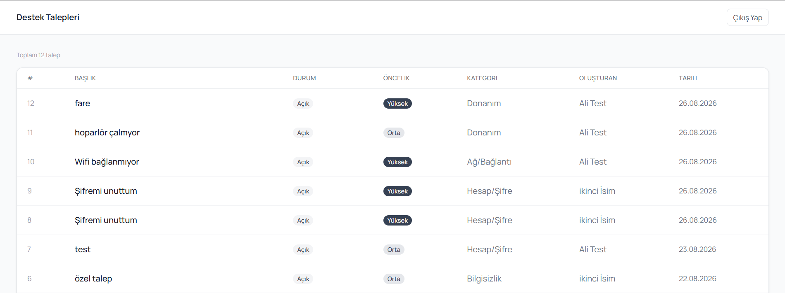
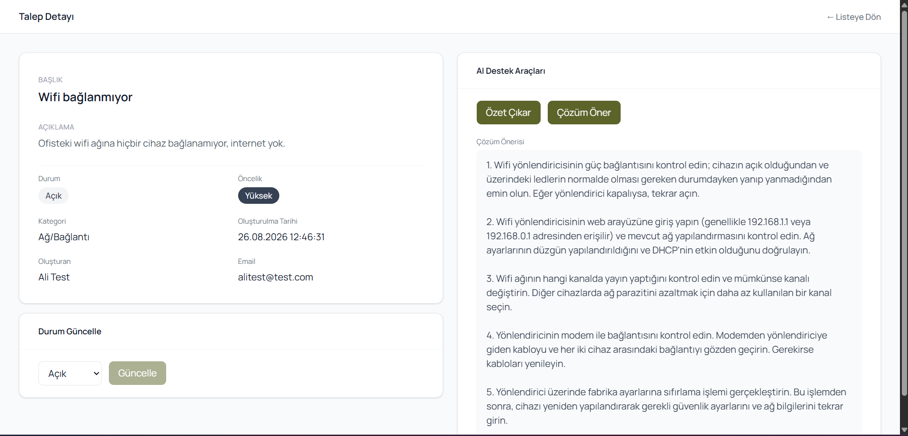
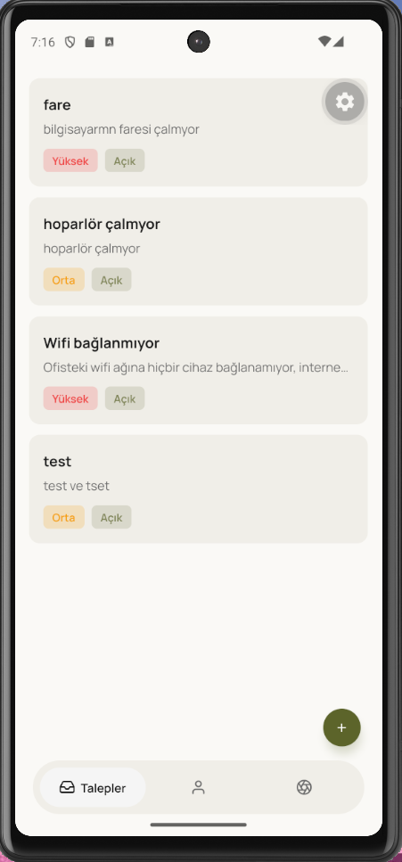
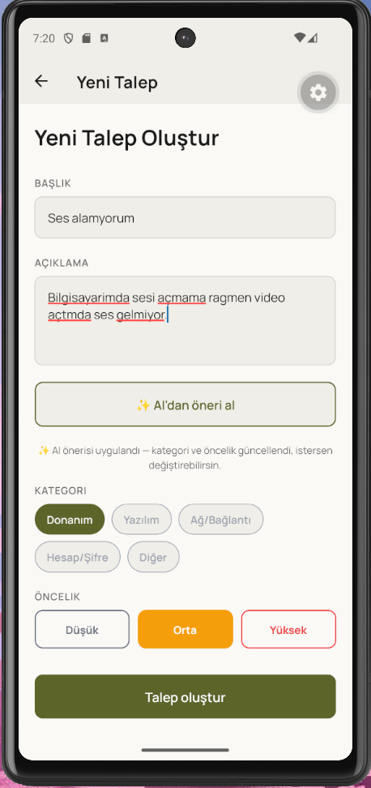
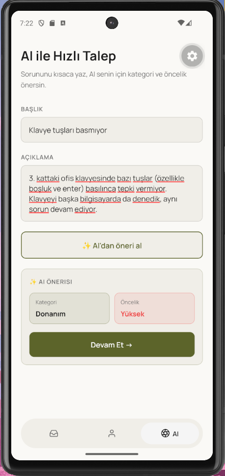
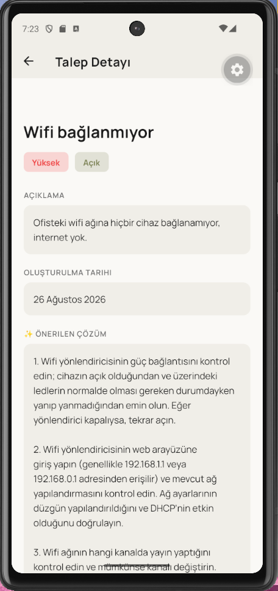
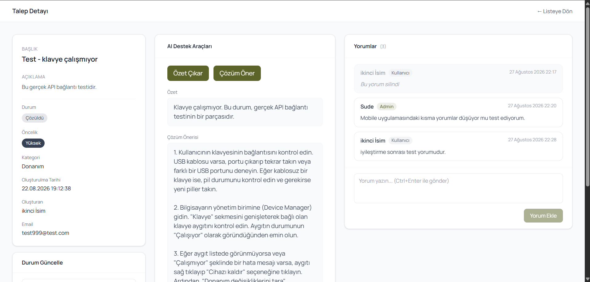
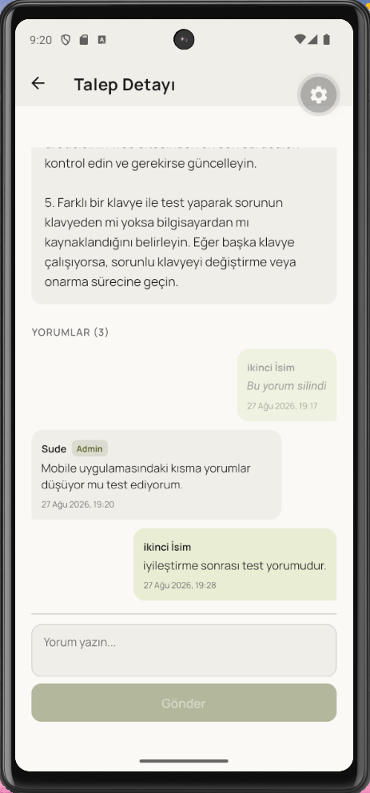

# destek-sistemi

AI destekli teknik destek talep takip sistemi. Kullanıcılar mobil uygulama üzerinden destek talebi oluşturup takip ederken, adminler web paneli üzerinden talepleri yönetir. OpenAI API entegrasyonu sayesinde sistem; talep oluşturma sırasında kategori ve öncelik önerisi sunar, admin panelinde talep özeti ve çözüm önerisi üretir — üretilen çözüm önerisi kullanıcının mobil ekranına da yansır. Ayrıca her talep üzerinde admin ile kullanıcı arasında karşılıklı yorum/yazışma yapılabilir.

## Özellikler

**Kullanıcı (Mobil)**
- Kayıt ve JWT tabanlı giriş/çıkış
- Talep oluşturma (AI destekli kategori & öncelik önerisi)
- Talep listesi ve detay takibi
- Kendi talebine yorum yazma ve admin yanıtlarını görüntüleme
- Profil yönetimi
- Light / Dark tema desteği

**Admin (Web Panel)**
- Tüm talepleri listeleme ve filtreleme
- Talep durumu güncelleme
- AI ile talep özeti çıkarma
- AI ile çözüm önerisi üretme (üretilen öneri mobilden de görüntülenebilir)
- Her talebe yorum yazarak kullanıcıyla karşılıklı yazışma

## AI Entegrasyonu (OpenAI GPT-4o mini)
- Talep başlık/açıklamasına göre kategori önerisi (mobil & admin panel)
- Talep başlık/açıklamasına göre öncelik önerisi (mobil & admin panel)
- Talep özeti üretme (yalnızca admin panelinden tetiklenir)
- Çözüm önerisi üretme (admin panelinden tetiklenir, mobilden görüntülenebilir)

## Ekran Görüntüleri

| | |
|:---:|:---:|
|  |  |
| **Admin Panel — Talep Listesi** | **Admin Panel — AI Özet & Çözüm Önerisi** |
|  |  |
| **Mobil — Talep Listesi** | **Mobil — AI Destekli Talep Oluşturma** |
|  |  |
| **Mobil — AI ile Hızlı Talep** | **Mobil — AI Çözüm Önerisi Görüntüleme** |
|  |  |
| **Admin Panel — Yorumlar** | **Mobil — Yorumlar** |

## Mimari

Mobil uygulama ve admin paneli birbirini tanımaz; her ikisi de bağımsız istemci olarak aynı NestJS backend'ine HTTPS + JWT ile bağlanır. Tüm AI işlemleri yalnızca backend tarafında gerçekleştirilir: OpenAI API anahtarı hiçbir zaman istemci tarafına gönderilmez. Backend, Prisma ORM aracılığıyla MySQL veritabanıyla iletişim kurar.

## Teknoloji Yığını

### Backend
- **NestJS** ^11.0.1 — REST API framework
- **Prisma** ^6.19.3 — ORM & migration yönetimi
- **MySQL** ^8 — Veritabanı
- **Passport + JWT** — Kimlik doğrulama
- **OpenAI SDK** ^7.5.0 — AI entegrasyonu
- **TypeScript** ^5.7.3

### Admin Panel
- **React** ^19.2.8 — UI framework
- **Vite** ^8.2.0 — Build aracı
- **React Router DOM** ^7.18.2 — Sayfa yönlendirme
- **Axios** ^1.19.0 — HTTP istemcisi
- **Tailwind CSS** ^4.3.3 — Stil
- **TypeScript** ~6.0.2

### Mobile
- **React Native** 0.86.2
- **Expo** ~57.0.15
- **React Navigation** ^7 — Stack & Tab navigasyon
- **Axios** ^1.19.0 — HTTP istemcisi
- **AsyncStorage** 2.2.0 — Yerel depolama
- **TypeScript** ~6.0.3

## Kurulum & Çalıştırma

Her alt proje kendi bağımlılıklarını ve yapılandırmasını bağımsız olarak yönetir. Detaylı kurulum adımları için ilgili README dosyalarına bakınız:

- [backend/README.md](backend/README.md)
- [admin-panel/README.md](admin-panel/README.md)
- [mobile-app/README.md](mobile-app/README.md)

## Lisans

Bu proje MIT lisansı ile lisanslanmıştır. Detaylar için [LICENSE](LICENSE) dosyasına bakınız.
